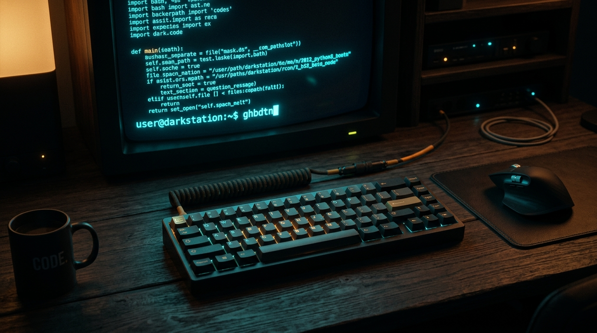
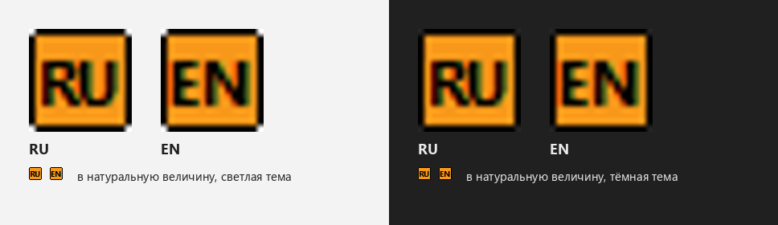
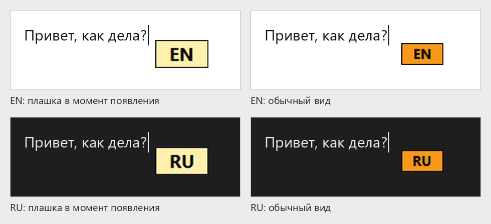
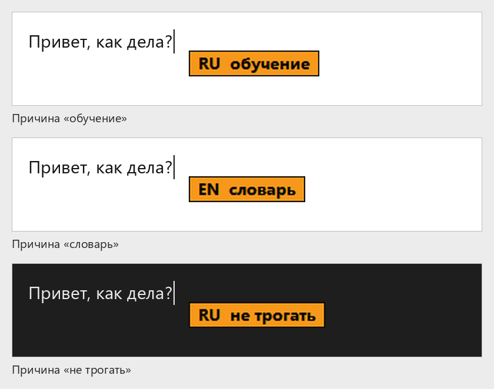
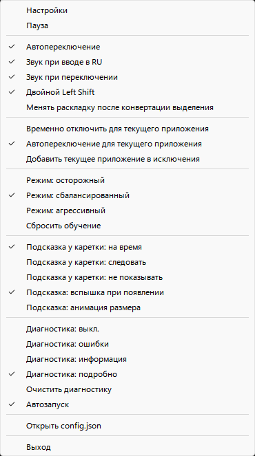
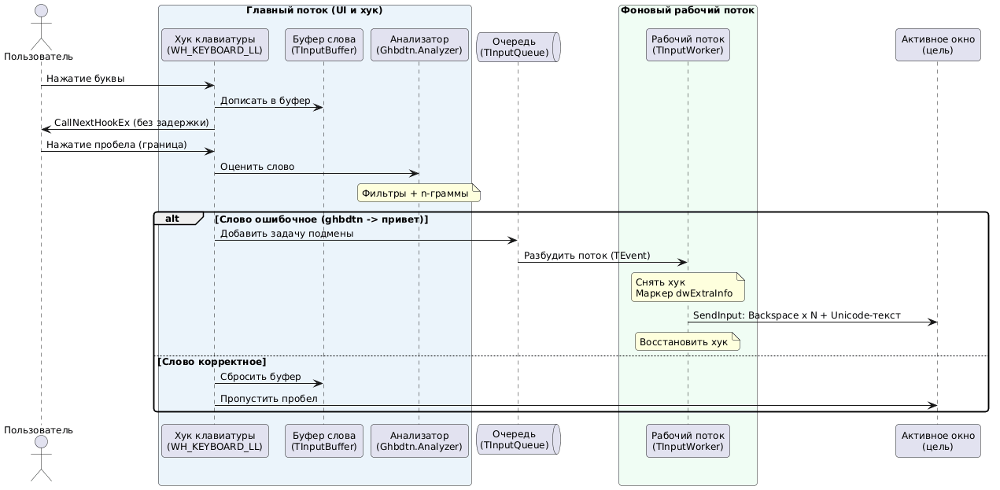
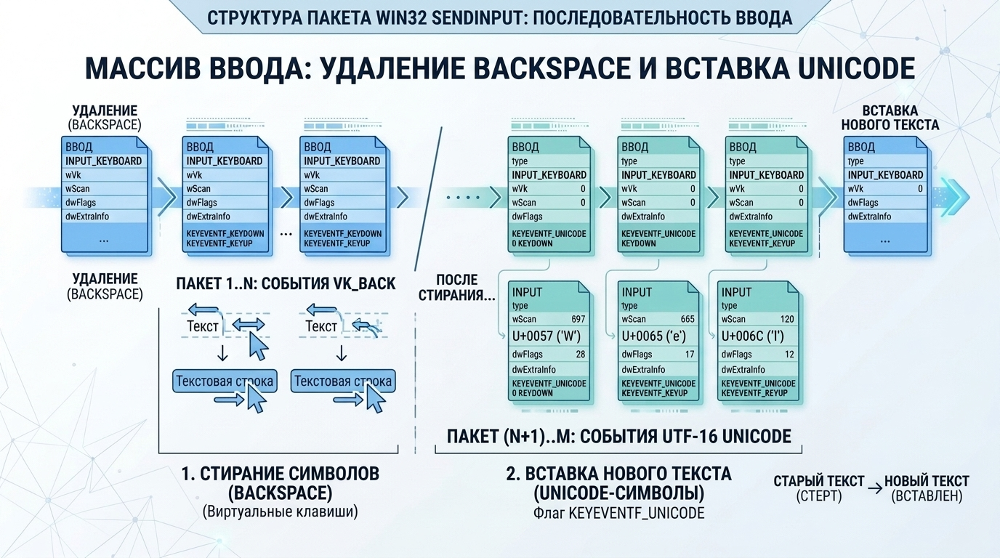

# Ghbdtn



**Ghbdtn** – аналог Punto Switcher / Caramba Switcher для Windows (только Win64), написанный на Delphi (RAD Studio 13 Florence).
Приложение работает в фоне, следит за набором текста и исправляет слова, набранные в неверной раскладке (русская / английская). Например, `ghbdtn` на английской раскладке превращается в `привет`.

---

## Возможности

- **Автопереключение раскладки.** Слово оценивается по n-граммам и спискам частых слов. Если среди пяти последних слов в этом окне два или больше одной раскладки, спорное следующее слово склоняется в ту же сторону; перекос не больше 3 баллов, явный словарь остаётся сильнее. Режимы эвристики: осторожный, сбалансированный, агрессивный. Решение принимается при вводе пробела, Enter, Tab, знака препинания, плюса, минуса или двоеточия. Часть в верной раскладке остаётся: `dev-c,jhrf` становится `dev-сборка`. Подчёркивание и знак равенства входят в слово. Одна буква перед двоеточием не переключается (`C:`). Запятая и точка на английской раскладке считаются буквами `б` и `ю`, если слово переводится в русский. Исправление стирает старое слово и вставляет новое одним пакетом клавиш.
- **Двойное нажатие Right Shift** меняет регистр выделенного текста, слова у каретки или слова, которое сейчас набирается. Каждая буква становится противоположного регистра: строчная – прописной, прописная – строчной. Повторное нажатие возвращает прежний регистр. Раскладка при этом не переключается.
- **Двойное нажатие Left Shift:**
  - перенабирает последнее слово в другой раскладке;
  - сразу после автоисправления отменяет его (повторное нажатие возвращает исходный текст);
  - если слова нет – конвертирует выделенный текст.
- **Конвертация выделения.** Выделите текст Shift+стрелками, Home, End, протягиванием мыши, двойным щелчком или Shift+щелчком и дважды нажмите Left Shift. Выделение копируется через буфер обмена и вставляется обратно, прежнее содержимое буфера восстанавливается сразу после вставки. Текст одного алфавита переводится целиком. В смешанном тексте меняются только слова неверной раскладки. Если выделения нет и слово сейчас не набирается, двойной Left Shift переводит слово у каретки. Выделение длиннее 4096 символов не конвертируется. Необязательно можно переключать раскладку после конвертации. Повторный двойной Left Shift сразу после конвертации возвращает прежний текст (однострочный, до 512 символов), следующий снова конвертирует; любое нажатие клавиши отменяет такой возврат.
- **Обучение.** Программа запоминает, как со словом обошлись, отдельно для каждого приложения. Общие записи из прежних настроек в списке видны, но в приложениях сами не действуют. В том же списке слово можно добавить вручную: не переключать или переключать, для одного приложения или для всех. Запись для всех действует там, где у приложения нет своей. Явная отмена автоисправления (Ctrl+Z или повторный двойной Left Shift) и стирание исправленного слова целиком сразу запрещают переключать его снова. Неполное стирание длинного слова учитывается слабее и начинает действовать после нескольких таких отказов. Если исправление оставлено и набор продолжается, случайный отказ постепенно забывается. Слово, которое пользователь сам переключил двойным Left Shift, в следующий раз переключается сразу; отмена этого переключения забывает предпочтение. Та же основа слова покрывает соседние формы (`машина` и `машины`, и такой же набор на английской раскладке). Одну запись можно удалить или сбросить список целиком.
- **Защита.** В полях ввода пароля программа ничего не делает: и в обычном поле Windows, и там, где признак пароля виден только через автоматизацию интерфейса (браузер, Electron). Слова с цифрами, адресами, путями, смешением алфавитов и короткие аббревиатуры в верхнем регистре не трогаются.
- **Правила для приложений.** Список исключений (по умолчанию `cmd.exe`, `powershell.exe`, `wt.exe`, `putty.exe`, поддерживаются маски `*` и `?`) и отдельные настройки автопереключения, звуков и режима эвристики для каждого приложения редактируются в настройках. Из меню трея можно временно отключить программу для текущего приложения, выключить ему автопереключение или добавить его в исключения. Клавиша Pause и пункт «Пауза» приостанавливают слежение до повторного нажатия.
- **Индикация.** Значок в трее с текущим языком (`RU` / `EN`, чёрный текст на оранжево-жёлтой плашке) и подсказка у каретки при смене раскладки (на время или следуя за кареткой, со вспышкой и анимацией размера). При заметном решении подсказка добавляет причину: «обучение», «словарь» или «не трогать».
- **Звук.** Два коротких сигнала при смене раскладки: второй выше при переходе на русский и ниже при переходе на английский. Клик при наборе на русской раскладке.
- **Автозапуск** с Windows (по желанию).
- **Диагностика.** Журнал `diagnostics.log` с уровнями «выкл.», «ошибки», «информация», «подробно» (подробный уровень в Release-сборке ограничен ошибками) и ротацией файлов.

---

## Внешний вид

Значок в трее для светлой и тёмной темы:



Подсказка у каретки при смене раскладки:



При заметном решении подсказка показывает причину:



---

## Меню трея и настройки

Клик правой кнопкой по значку открывает меню. Часть пунктов дублируется в окне **Настройки**.



- Настройки
- Пауза
- Автопереключение, звук при вводе в RU, звук при переключении, двойной Left Shift
- Менять раскладку после конвертации выделения
- Временно отключить для текущего приложения; автопереключение для текущего приложения; добавить текущее приложение в исключения
- Режим эвристики; сброс обучения
- Подсказка у каретки: режим, вспышка, анимация
- Уровень диагностики; очистка журнала; автозапуск
- Открыть `config.json`
- Выход

---

## Конфигурация

Параметры хранятся в `config.json` рядом с `Ghbdtn.exe` и сохраняются атомарно с резервной копией `config.json.bak`. Повреждённый файл переименовывается в `config.corrupt-<дата>.json`, настройки восстанавливаются из копии или сбрасываются по умолчанию.

```json
{
  "SchemaVersion": 4,
  "SoundOnRussianInput": true,
  "SoundOnSwitch": true,
  "DoubleLeftShiftEnabled": true,
  "SwitchLayoutAfterSelection": false,
  "AutoSwitchEnabled": true,
  "AutoStart": false,
  "HeuristicMode": "balanced",
  "DiagnosticsLevel": "off",
  "CaretHintOffsetX": 14,
  "CaretHintOffsetY": 18,
  "CaretHintMode": "timed",
  "CaretHintFlash": true,
  "CaretHintAnimate": true,
  "Exclusions": ["cmd.exe", "powershell.exe", "wt.exe", "putty.exe"],
  "ApplicationRules": {
    "notepad.exe": { "AutoSwitchEnabled": false, "HeuristicMode": "cautious" }
  },
  "NeverSwitchLearning": {},
  "PreferSwitchLearning": {}
}
```

- `HeuristicMode`: `cautious`, `balanced`, `aggressive`.
- `CaretHintMode`: `timed`, `follow`, `off`.
- `DiagnosticsLevel`: `off`, `error`, `info`, `verbose`.
- В `ApplicationRules` ключ – имя exe или маска; в правиле можно задать `AutoSwitchEnabled`, `SoundOnRussianInput`, `SoundOnSwitch`, `HeuristicMode`. Необъявленные поля берутся из общих настроек.
- `NeverSwitchLearning` – сколько раз слово просили не переключать во всех приложениях. `PreferSwitchLearning` – сколько раз его переключили вручную, тоже для всех. Эти общие записи в приложениях сами не действуют. `ApplicationLearning` хранит такие же счётчики отдельно для каждого exe. Ключ `*` в `ApplicationLearning` действует во всех приложениях, у которых нет своей записи. Порог, после которого решение меняется, равен 3. Старый список `NeverSwitchWords` читается как уже набранный порог.

---

## Как это работает

Хук клавиатуры копит набираемое слово в буфере и не задерживает нажатия. На границе слова анализатор оценивает его, а замену выполняет отдельный рабочий поток:



Замена отправляется одним пакетом `SendInput`: сначала события Backspace, затем текст в Unicode.



---

## Состав репозитория

- `Ghbdtn.dpr`, `Ghbdtn.dproj` – проект RAD Studio (платформа **Win64**).
- `build.bat` – сборка через MSBuild (`Debug` / `Release`).
- `src\` – исходники:
  - `Ghbdtn.App` – скрытая главная форма, меню трея, таймер слежения за раскладкой.
  - `Ghbdtn.Hook` – низкоуровневые хуки клавиатуры и мыши, буфер слова, жесты Left Shift, правила приложений.
  - `Ghbdtn.KeyState` – чистая логика состояния Left Shift и вспомогательные проверки.
  - `Ghbdtn.Learning` – учет отказов, подтверждений и ручных переключений.
  - `Ghbdtn.Buffer` – буфер набираемого слова.
  - `Ghbdtn.Layout` – раскладки WinAPI, таблицы соответствия RU/EN, конвертация символов.
  - `Ghbdtn.Heuristics` – оценка слова по n-граммам и спискам частых слов.
  - `Ghbdtn.Phrase` – язык нескольких последних слов и перекос счёта.
  - `Ghbdtn.Analyzer` – решение о переключении, защищённые слова, анализ выделения.
  - `Ghbdtn.InputQueue`, `Ghbdtn.InputWorker` – очередь и рабочий поток замены текста (в том числе через буфер обмена).
  - `Ghbdtn.Fixer` – отправка помеченного ввода через `SendInput`.
  - `Ghbdtn.Password` – определение полей ввода пароля.
  - `Ghbdtn.Settings`, `Ghbdtn.SettingsForm` – параметры, `config.json`, окно настроек.
  - `Ghbdtn.TrayIcon`, `Ghbdtn.CaretHint`, `Ghbdtn.Sound` – значок в трее, подсказка у каретки, звуки.
  - `Ghbdtn.AutoStart`, `Ghbdtn.SingleInstance`, `Ghbdtn.Diagnostics` – автозапуск, единственный экземпляр, журнал.
- `tests\` – модульные тесты (DUnitX).
- `bin\` – результат сборки (`Ghbdtn.exe`, `config.json`), в репозиторий не попадает.

---

## Сборка и тесты

Нужна RAD Studio 13 Florence (путь к `rsvars.bat` задан в `build.bat`).

```bat
.\build.bat                 :: Debug
.\build.bat Release Win64   :: Release
.\tests\build-tests.bat     :: сборка и запуск тестов
```

Готовый файл – `bin\Ghbdtn.exe`.

---

## Лицензия

Mozilla Public License 2.0, см. файл [LICENSE](LICENSE).
